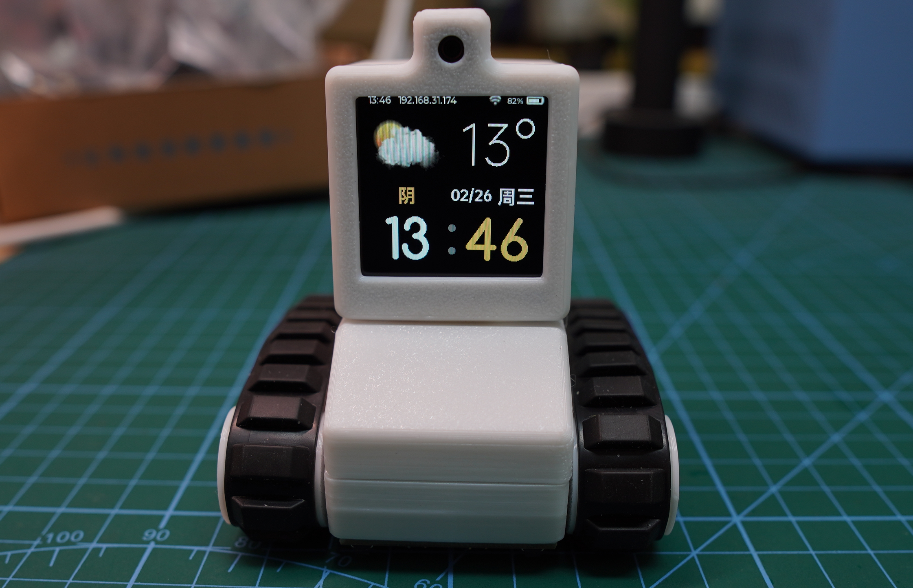
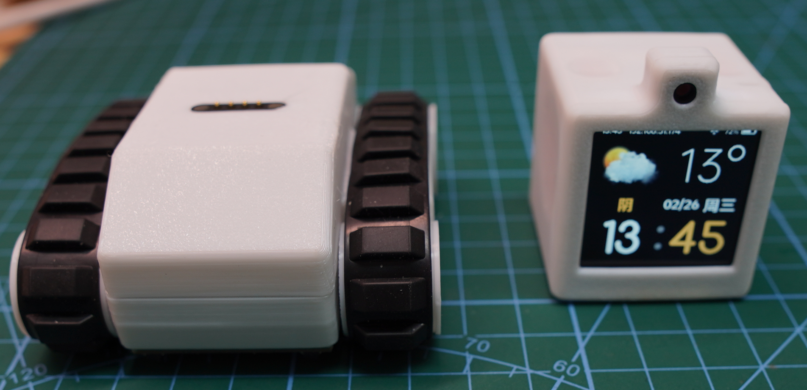
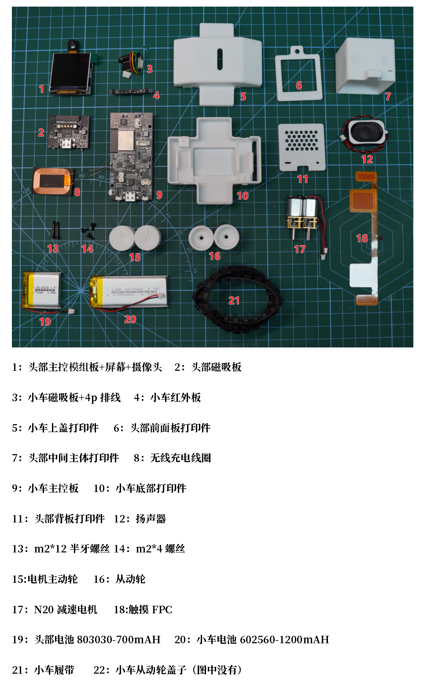
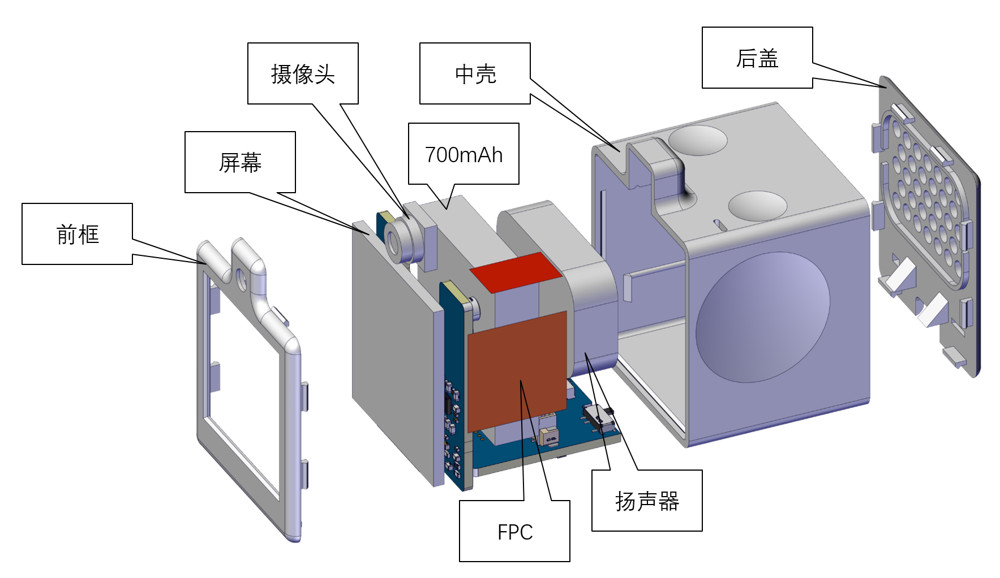
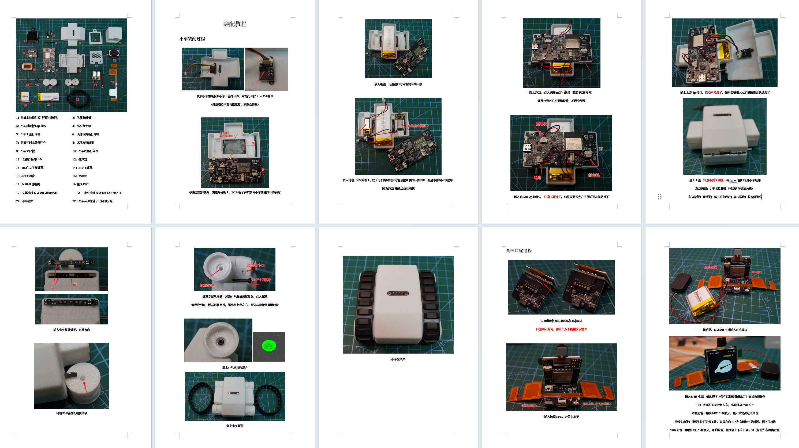
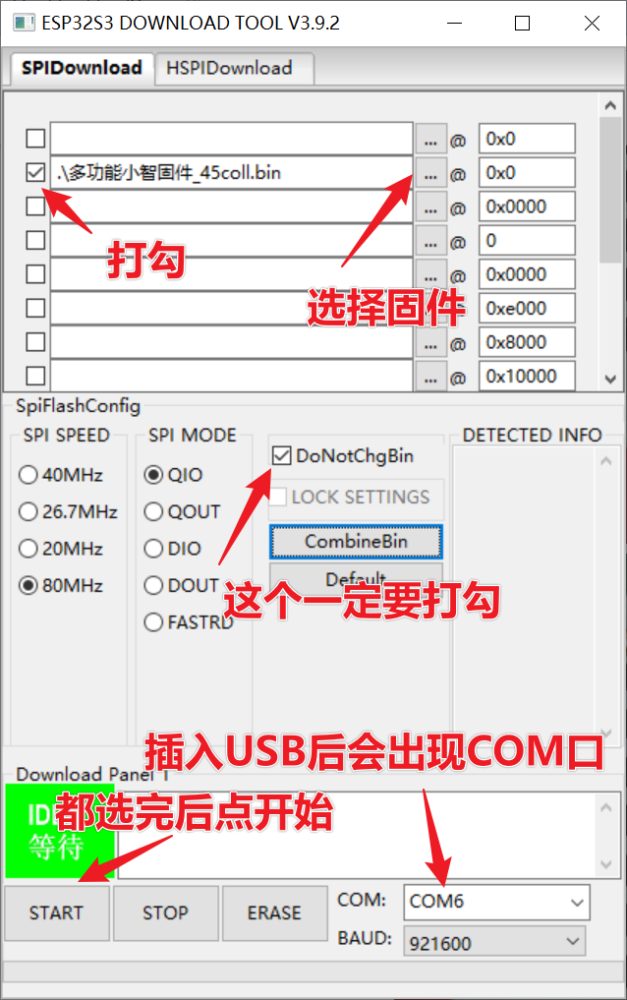
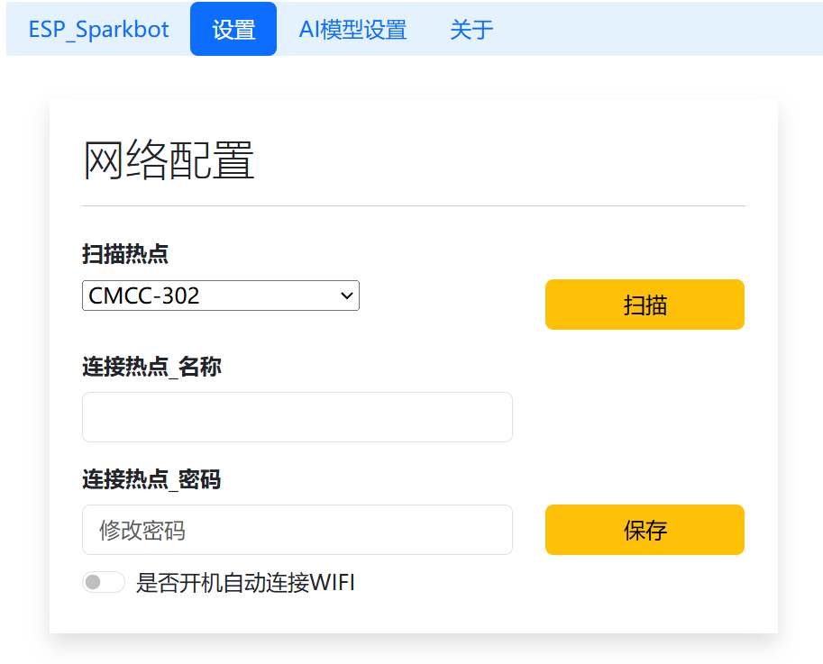

# Sparkbot_45coll版本--无线充电、红外巡线
## 1.项目介绍
在[[乐鑫开源的sparkbot]](https://oshwhub.com/esp-college/esp-sparkbot)基础上进行了修改，主要添加了无线充电、小车巡线等功能。同时也对硬件进行了优化，优化了供电方案，小车电池可以给头部充电了；小车实现一键开关机功能，在无运动时，10秒自动关机省电。触摸按键也变成了四个，方便后续功能的添加。在软件上进行了整合，目前已实现的功能：`天气、2048、木鱼、骰子、小车网页控制、小车巡线、AI对话、AI对话控制小车、摄像头`

[【sparkbot】AI大模型控制机器人】](https://www.bilibili.com/video/BV1ExNke9EEh/?share_source=copy_web) 

[项目软件开源gitee](https://gitee.com/coll45/sparkbot-45coll)

[立创PCB开源工程](https://oshwhub.com/45coll/sparkbot-45coll)

## 2.制作说明
头部主控芯片为esp32s3-wroom-1-n16r8,立创原理图那边是1u，但是最终还是用了有板载天线的，记得不要买错了；小车主控芯片为esp32c3

具体bom在gitee里面的【sparkbot物料清单.xls】里面有两个表格一个是元器件，一个是需要淘宝购买的

pcb：pcb打板都是2层板，1.6mm厚,`在立创下单参数都为默认`，只有颜色可以修改。可以试着打拼版`sparkbot整合`到手用斜口钳剪

fpc:不太方便免费打板，本人店铺有单独售卖——[淘宝：45智造小店](https://shop177142330.taobao.com/)  

店铺内也有成品369售卖，价格和自制做一个差不多

## 结构说明
打印件可以通过立创的三维猴打印，直接上传`3D打印件_by：虫二`文件夹内的文件即可，一共有8个打印件，其中`.stl`轮子需要打印2个，其余`.step`的只需要打印1个

在本人淘宝店铺也有售全套打印件

## 组装说明
在gitee教程类文件夹中有`sparkbot_45coll装配教程.pdf`

## 代码烧录
USB烧录方法：打开附件文件夹内的`flashdownload/flash_download_tool_3.9.2.exe` 选择esp32s3，loadmode改成USB，选择对应的bin文件，下载到自己电脑bin文件地址会变，需要重新选（多功能小智固件_45coll.bin烧录到0x0位置），USB数据线连接，选择对应的com口。点start开始烧录。烧录完成后拔掉typec 再次插入就可以看见效果

小车bin烧录同理，用`flashdownload/flash_download_tool_3.9.2.exe` 选择esp32c3，loadmode改成USB,选择对应的bin文件（tank.bin烧录到0x0位置）

头部bin文件烧录会要挺久（大概1分钟），因为bin文件有点大14mb

bin文件在`flashdownload`文件夹内
## WIFI功能说明

在天气页面长按顶部触摸按键，屏幕出现 192.168.4.1 ，然后手机/电脑搜索wifi，sparkbot-xxxxxx。然后连接wifi后浏览器访问 192.168.4.1 ，在设置界面中填入wifi账号密码，然后点启用自动连接WiFi，注意wifi不能连5g的，目前也不支持5g和2.4同频的

整合了小车控制页面，在机器人的AP模式或者STA模式均可实现控制

配网完成后，屏幕上出现的192.168.xxx.xxx是头部联网成功后获到的本地IP，可以在同一个wifi局域网下，浏览器访问这个网址，来实现控制小车或者重新配网
## 常见问题：
1. AI对话唤醒词：“你好小智”，唤醒后会切换屏幕到对话页面
2. 对话页面，单击头部是切换对话模式，例如AI在说话中，摸一下头部会结束说话，进入聆听模式。在聆听模式摸一下头部会结束对话，回到天气页面。
3. 因为up售卖的版本用的陀螺仪芯片为bmi220，发布到gitee的默认固件也是bmi220的，如果DIY自制用到了bmi270芯片，可以烧录flashdownload/bmi270/多功能小智固件_bmi270.bin这个固件来使用陀螺仪功能

## 功能说明
在gitee教程类文件夹中有，使用说明书.pdf

## 源码
已经上传至[gitee](https://gitee.com/coll45/sparkbot-45coll)，开发环境为vscode esp-idf 代码在`code`文件夹内 

源码为原版乐鑫的方案，和bin文件的小智固件不同，多功能小智固件暂时不开源

开发idf版本5.3.2（必须用5.3以上的版本），可直接编译运行源码，但是源码里面没有api key需要自己注册申请对应的api key

具体原版和45coll版本的引脚改动在code文件夹的config.h里面有说明，注释部分为原版的引脚，#define的部分为45coll版本使用的引脚。改动原因也写在注释后面了，可以参考

## 未来计划（画饼）
项目初衷是加个无线充电、小车巡线，让小车玩的功能更多。AI控制小车执行运动功能。个人观点：该项目比起AI对话盒子多了可控制的部分，增加了可玩性

1. 番茄时钟
2. 模拟物理（把陀螺仪给用上）
3. AI对话调用摄像头识别物品
4. 优化AI对话速度，让其实现3s以内回复（已实现，AI换成了AI小智）
5. 更多表情动画（lottie动效）
6. AI对话调用函数发送mqtt控制智能家居

## 沟通与交流
QQ群：1034095444

## 感谢与引用
[无线接收参考](https://oshwhub.com/mondraker/6666)

非常感谢虫二大佬的结构设计 [fywbchong2](https://space.bilibili.com/438787726)
