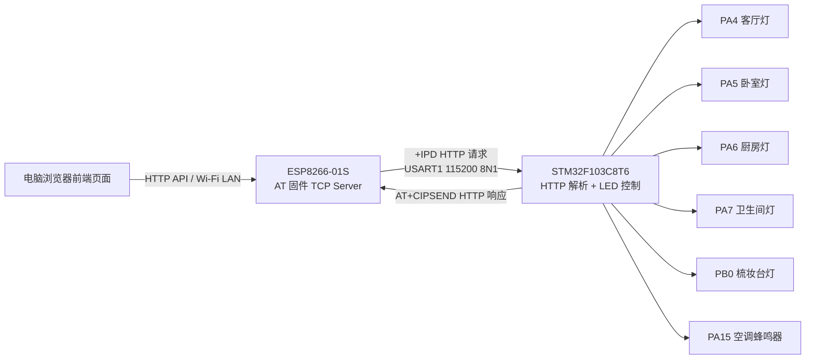

# 系统架构

ESP8266-01S 只承担 Wi-Fi 接入和 TCP Server 功能。STM32 发送 AT 指令完成初始化，浏览器请求进入 ESP8266 后以 `+IPD,<id>,<len>:` 形式经 UART 转发给 STM32。STM32 解析 HTTP method、path 和 query string 后控制 LED，再通过 `AT+CIPSEND=<id>,<length>` 返回 JSON 响应，并关闭连接。

启动流程：

1. STM32 初始化 SysTick、LED GPIO 和 USART1。
2. STM32 发送 `AT`、`ATE0`、`AT+CWMODE=1`。
3. 尝试 `AT+CWHOSTNAME="smart-home-stm32"`。
4. 通过 `AT+CWJAP` 连接 Wi-Fi。
5. 发送 `AT+CIFSR` 查询 IP。
6. 发送 `AT+CIPMUX=1`。
7. 发送 `AT+CIPSERVER=1,80`。
8. 主循环持续处理 ESP8266 UART 接收缓冲区中的 `+IPD` 请求。
