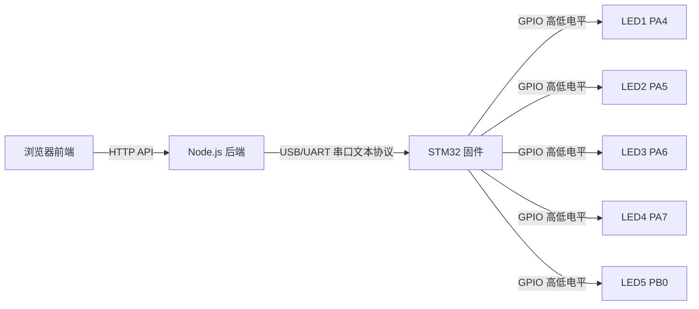

# 智能家居 STM32 LED 控制项目

本项目演示如何通过浏览器 Web 页面，经由本地 Node.js 后端和串口协议，控制 STM32 开发板上的 5 个 LED，实现一个适合教学和展示的“智能家居灯光控制面板”。

## 项目结构

```text
smart-home-stm32-led-control/
├── firmware/
│   ├── Core/
│   │   ├── Inc/
│   │   │   ├── main.h
│   │   │   └── gpio_led.h
│   │   └── Src/
│   │       ├── main.c
│   │       ├── gpio_led.c
│   │       └── usart_protocol.c
│   ├── README.md
│   └── stm32cube_notes.md
├── backend/
│   ├── package.json
│   ├── server.js
│   ├── serial.js
│   ├── config.js
│   └── README.md
├── frontend/
│   ├── index.html
│   ├── src/
│   │   ├── main.js
│   │   ├── api.js
│   │   └── style.css
│   └── README.md
├── docs/
│   ├── wiring.md
│   ├── protocol.md
│   └── demo_steps.md
└── README.md
```

## 功能特性

- Web 可视化控制 5 个 LED 灯
- 支持单灯开关、全开、全关、状态刷新
- 浏览器无需直接访问串口，由本地后端代理通信
- STM32 使用 UART 文本协议，便于调试和扩展
- 前端显示后端在线状态、串口状态、STM32 响应状态
- 适合 STM32 入门、串口协议教学、前后端联调演示

## 系统架构



## 硬件准备

- 一块 STM32 开发板
  - 示例 1：STM32F103C8T6
  - 示例 2：STM32F401RE
- 5 个 LED
- 5 个限流电阻（推荐 220Ω 或 330Ω）
- USB 数据线
- 串口连接方式
  - 开发板自带 USB CDC / 虚拟串口，或
  - USB 转串口模块（TX/RX/GND）

## LED 接线说明

默认逻辑为高电平点亮，低电平熄灭。

| 灯名称 | LED ID | STM32 引脚 |
|---|---:|---|
| 客厅灯 | 1 | PA4 |
| 卧室灯 | 2 | PA5 |
| 厨房灯 | 3 | PA6 |
| 卫生间灯 | 4 | PA7 |
| 梳妆台灯 | 5 | PB0 |

推荐接法：

- GPIO 引脚 → LED 正极
- LED 负极 → 限流电阻 → GND

如果你的硬件是低电平点亮，只需修改 [`LED_ACTIVE_HIGH`](firmware/Core/Inc/gpio_led.h) 宏即可。

详细接线见 [`docs/wiring.md`](docs/wiring.md)。

## STM32 固件说明

固件代码位于 [`firmware/`](firmware/)。

核心能力：

- 初始化 5 个 LED GPIO
- 通过 UART 接收文本命令
- 支持命令：`SET x ON`、`SET x OFF`、`ALL ON`、`ALL OFF`、`STATUS`
- 返回响应：`OK`、`ERR`、`STATUS ...`

建议先使用 STM32CubeMX / STM32CubeIDE 生成一个基础 HAL 工程，再将本项目中的核心文件复制进去。

详细说明见：

- [`firmware/README.md`](firmware/README.md)
- [`firmware/stm32cube_notes.md`](firmware/stm32cube_notes.md)

## 后端运行说明

后端代码位于 [`backend/`](backend/)。

### 1. 安装依赖

```bash
cd backend
npm install
```

### 2. 配置串口

默认配置见 [`backend/config.js`](backend/config.js)：

- Windows：`COM3`
- macOS：`/dev/tty.usbserial-xxxx`
- Linux：`/dev/ttyUSB0`

也可以通过环境变量覆盖：

```bash
SERIAL_PORT=COM5 npm start
```

Windows CMD 示例：

```cmd
set SERIAL_PORT=COM5 && npm start
```

### 3. 启动后端

```bash
cd backend
npm start
```

启动后默认监听：

- `http://localhost:3000`

## 前端运行说明

前端代码位于 [`frontend/`](frontend/)。

这是一个纯静态页面，可以直接打开 [`frontend/index.html`](frontend/index.html)，也可以通过任意静态服务器启动。

推荐方式：

### 方式 1：直接双击打开

直接在浏览器中打开 [`frontend/index.html`](frontend/index.html)。

### 方式 2：使用静态服务器

例如 VS Code Live Server，或 Python 简单服务器：

```bash
cd frontend
python -m http.server 8080
```

然后访问：

- `http://localhost:8080`

## API 文档

### [`GET /api/health`](backend/server.js)

返回后端运行状态、串口状态。

### [`GET /api/leds`](backend/server.js)

返回当前缓存的 5 个灯状态。

### [`POST /api/leds/:id`](backend/server.js)

设置单个灯状态。

请求体：

```json
{
  "state": true
}
```

### [`POST /api/leds/all`](backend/server.js)

设置全部灯状态。

请求体：

```json
{
  "state": false
}
```

### [`GET /api/leds/status`](backend/server.js)

主动向 STM32 查询实时状态，并返回解析结果。

## 串口协议文档

协议详细说明见 [`docs/protocol.md`](docs/protocol.md)。

命令示例：

```text
SET 1 ON
ALL OFF
STATUS
```

响应示例：

```text
OK
ERR
STATUS 1:ON 2:OFF 3:ON 4:OFF 5:OFF
```

## 常见问题排查

### 1. 后端启动了，但页面提示串口异常

原因可能包括：

- 串口号配置错误
- STM32 未连接电脑
- 串口被其他软件占用
- 波特率不是 115200

处理方法：

- 检查设备管理器中的串口号
- 修改 [`backend/config.js`](backend/config.js) 或环境变量 `SERIAL_PORT`
- 关闭串口调试助手、CubeMonitor 等占用程序

### 2. 点击按钮后 LED 没反应

检查：

- 固件是否已正确烧录
- UART 是否配置为 115200 8N1
- 接线是否正确
- LED 是否为高电平点亮接法
- 是否需要把 [`LED_ACTIVE_HIGH`](firmware/Core/Inc/gpio_led.h) 改为 `0`

### 3. 前端能打开，但请求失败

检查：

- 后端是否运行在 `3000` 端口
- 浏览器控制台是否有网络错误
- 是否被防火墙拦截

### 4. STM32 返回 ERR

说明发送了非法命令，或固件协议解析失败。请检查：

- 后端发送格式是否被修改
- 串口是否混入其他调试输出
- 每条命令是否以换行符结束

## 后续可扩展方向

- 增加 PWM 调光功能
- 增加房间场景模式（回家模式、睡眠模式）
- 增加定时任务
- 增加 WebSocket 实时状态推送
- 增加温湿度、门磁、人体传感器联动
- 增加用户登录与权限控制

## 文档索引

- 接线说明：[`docs/wiring.md`](docs/wiring.md)
- 协议说明：[`docs/protocol.md`](docs/protocol.md)
- 演示步骤：[`docs/demo_steps.md`](docs/demo_steps.md)
- 固件说明：[`firmware/README.md`](firmware/README.md)
- 后端说明：[`backend/README.md`](backend/README.md)
- 前端说明：[`frontend/README.md`](frontend/README.md)
