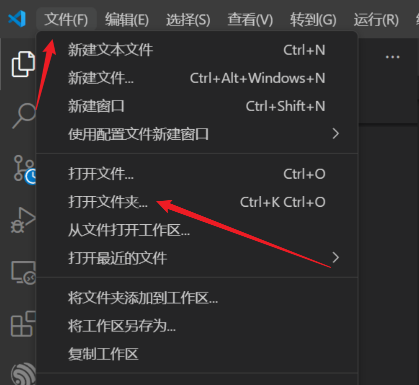
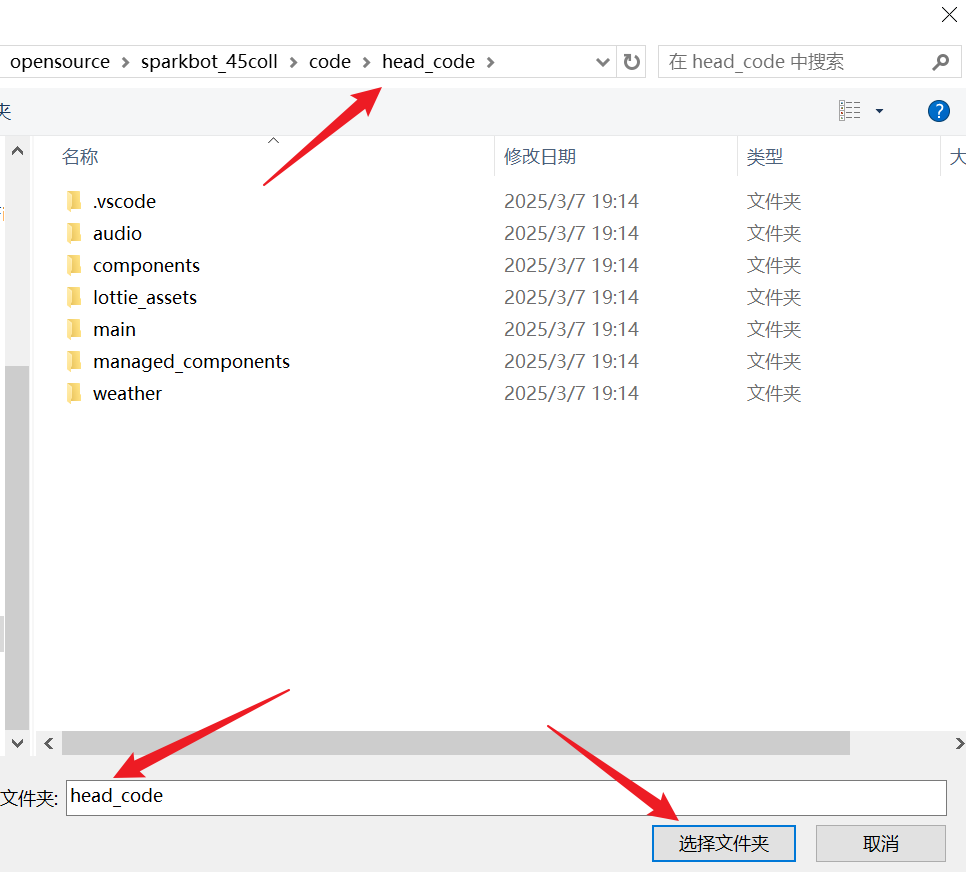
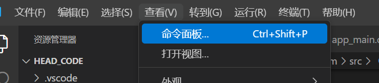
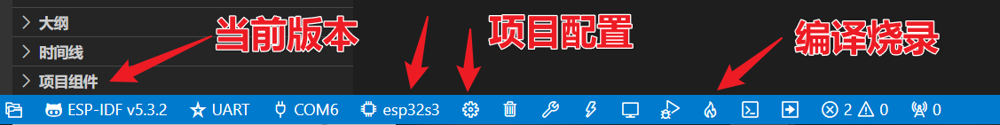
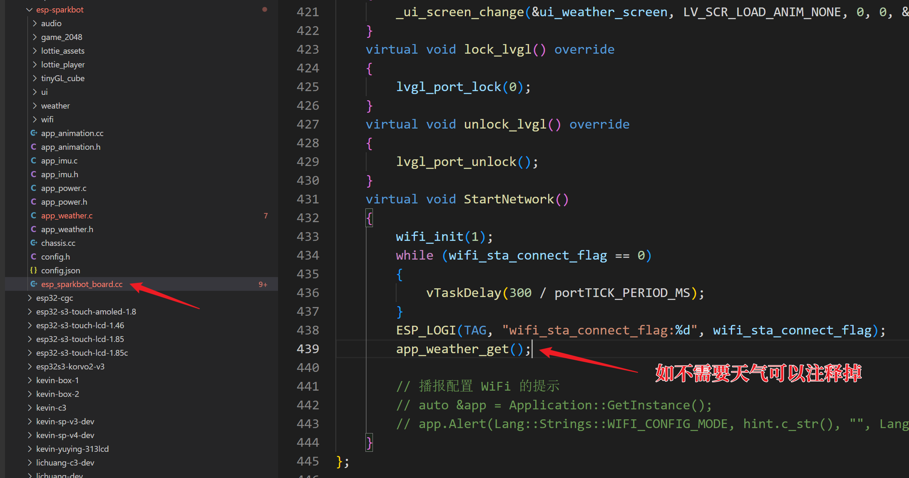
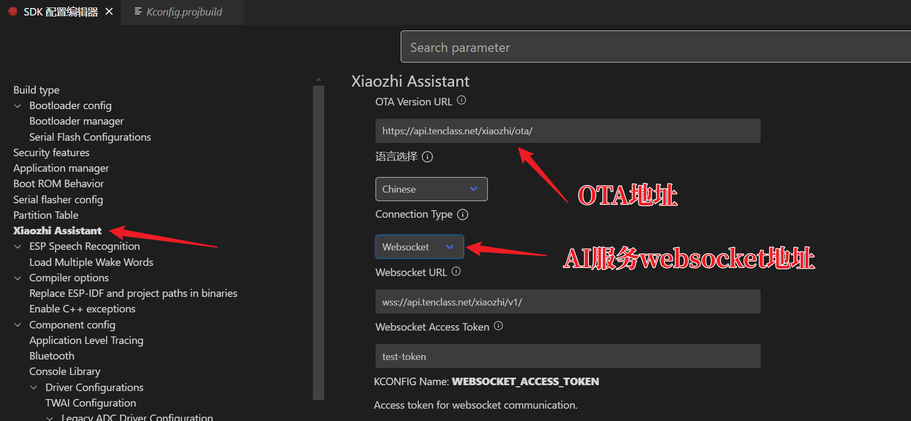

# 代码说明
## 1. 代码环境
- 开发环境：windows10及以上；mac应该是不支持的；linux有对应的环境，请在esp32官方文档中查看如何安装
- 开发软件vscode idf
- idf 版本：v5.3.2
- 目标芯片：机器人头部芯片esp32s3；小车芯片esp32c3
- 环境安装教程视频：[【立创·实战派ESP32-C3【手把手带你拥有项目经验】教程】 https://www.bilibili.com/video/BV1Jm411r7zz/?p=2](https://www.bilibili.com/video/BV1Jm411r7zz/?p=2)
- ！！！！本项目使用的是v5.3.2版本，不要使用其他版本，否则会出现编译错误！！！！

## 2. 代码说明
- 代码分为两个部分，一个是机器人头部，一个是小车
- 机器人头部代码在head_code文件夹中，小车代码在tank_code文件夹中
- 机器人头部代码使用的是esp32s3芯片，小车代码使用的是esp32c3芯片
- head_code文件夹是在小智1.5.2版本基础上，用lvgl8库进行开发的
- 关于源码部分不会进行解答，有问题请自行解决
- 源码在发布时能保证是可以运行在sparkbot-45coll版本的硬件上的
## 3. 代码编译
- 打开vscode，打开项目文件夹

- 选择对应文件夹；以机器人头部为例，选择head_code文件夹

- 查看-控制面板，输入add vs code configuration folder。将vscode添加到当前项目文件夹中

- 检查vscode窗口最下面是否配置正常，版本是否为5.3.2；目标芯片是否为esp32s3；可以点一下项目配置这个齿轮，看看环境是否正常；如果正常，就可以编译了

- 插入USB选择对应的COM口，点编译烧录即可

## 头部代码说明

- 代码需要申请高德地图API以获取IP地址的位置信息，还需要申请和风天气API以获取天气信息。
- 对应的代码在main\boards\esp-sparkbot\esp_sparkbot_board.cc文件中

- [高德地图API](https://lbs.amap.com/)
- [和风天气API](https://dev.qweather.com/)

## 小车代码说明
- 小车代码不需要修改和配置，直接编译就可以使用了，注意选一下目标芯片esp32c3芯片

## 如何接入自建服务器
在个人电脑上部署服务器，可以参考以下第三方开源的项目：
- [xinnan-tech/xiaozhi-esp32-server](https://github.com/xinnan-tech/xiaozhi-esp32-server) Python 服务器
- [joey-zhou/xiaozhi-esp32-server-java](https://github.com/joey-zhou/xiaozhi-esp32-server-java) Java 服务器
- [AnimeAIChat/xiaozhi-server-go](https://github.com/AnimeAIChat/xiaozhi-server-go) Golang 服务器

本项目因为用的是小智1.5.2版本，所以需要在项目配置（vscode窗口最下方的齿轮）里面修改AI服务器的地址

参考视频
- [小智AI服务端本地部署完整教程，任意音色 任意模型随意切换！](https://www.bilibili.com/video/BV1gePuejEvT/?share_source=copy_web&vd_source=7d38e9da3022eec5e8c93543e4466e4d)
- [小智AI服务端本地部署一键包，带一键更新功能，内置Conda运行环境，告别繁琐的环境配置！开箱即用！附配置烧录教程](https://www.bilibili.com/video/BV1HLRMYTE8H/?share_source=copy_web&vd_source=7d38e9da3022eec5e8c93543e4466e4d) 